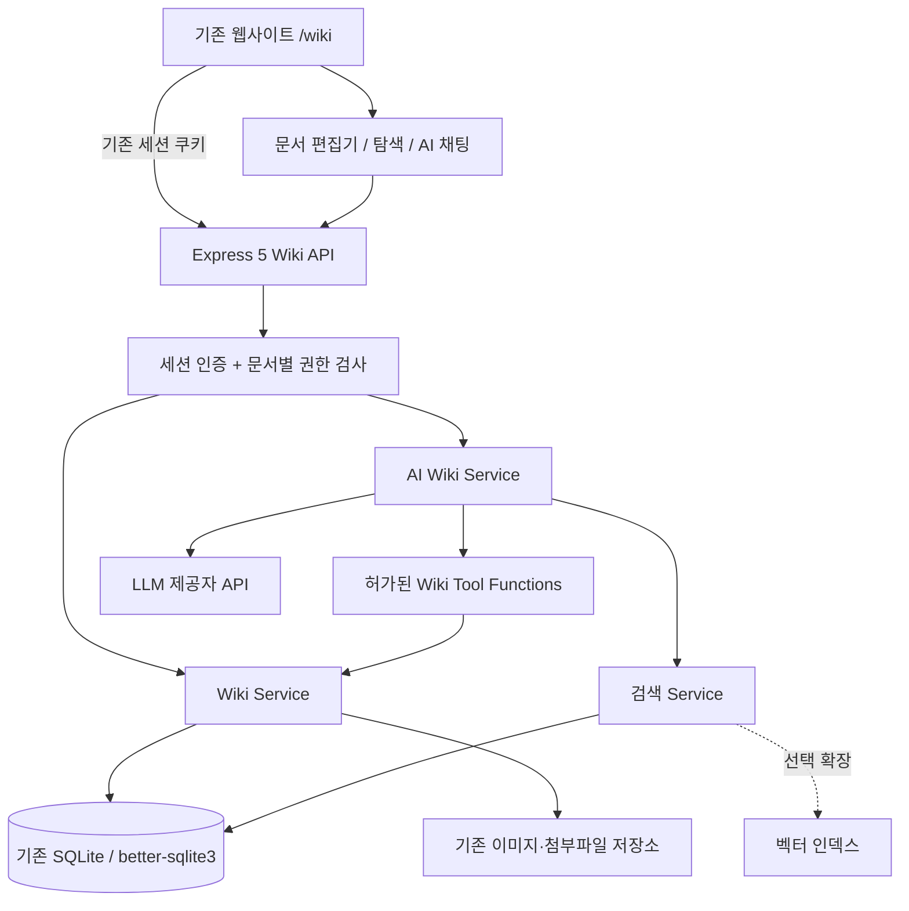

# 개인 AI 위키 구축 계획서

> **목표:** 기존 웹사이트에 나무위키·옵시디언형 문서관리 기능을 완전히 통합하고, AI가 위키를 **검색·읽기·초안 작성·수정 제안·문서 연결**할 수 있도록 한다.  
> **문서 상태:** 구현 착수용 설계 초안 (v1.0, 2026-10-12)  
> **원칙:** 기존 사이트·인증·SQLite를 유지한다. 위키 엔진을 별도 서비스나 iframe으로 붙이지 않는다.

## 0. 현재 환경과 확인 사항

### 확인된 기술 스택

| 항목 | 현재 환경 | 적용 방침 |
|---|---|---|
| 런타임 | Node.js 22.13.0 이상 | 유지 |
| 백엔드 언어 | TypeScript | 유지 |
| API 서버 | Express 5 | 기존 앱에 `/api/wiki` 라우트 추가 |
| 데이터베이스 | SQLite + `better-sqlite3` | 기존 DB에 위키 테이블만 추가 |
| 로그인 세션 | `express-session` + SQLite 세션 저장소 | 세션 인증 재사용 |
| 이미지 처리 | Sharp | 필요하면 위키 이미지 업로드에도 재사용 |
| 개발 실행 | `tsx` + `nodemon` | 기존 개발 흐름 유지 |
| 배포 | TypeScript 빌드 후 Node.js 실행 | 기존 빌드·배포 흐름 유지 |
| 프론트 코드 단서 | `frontend/src/features/posts/*.tsx` 등의 경로가 대화에 등장 | React/TSX 계열로 **추정**. 실제 의존성 확인 후 에디터 확정 |

**아직 확인하지 않은 사항:** 프론트엔드 프레임워크·라우터, 기존 사용자 테이블과 DB 마이그레이션 방식, 업로드 저장 방식, 기존 게시글과 위키의 연결 규칙, AI 제공자/모델 및 호출 정책. 아래의 폴더/코드는 **권장안**이며 실제 저장소 조사 후 맞춘다.

## 1. 목표와 범위

### 1.1 제품 정의

- `/wiki` 경로에서 기존 사이트와 동일한 헤더, 사이드바, 디자인 및 로그인 경험 제공
- 문서는 파일 목록이 아니라 **페이지·계층·태그·연결 관계·수정 이력**을 가진 위키 항목으로 관리
- 사람과 AI가 동일한 문서 API를 사용하되, AI의 변경은 **초안 → 차이 비교 → 승인 → 저장** 순서로 처리
- Markdown을 **원본 포맷**으로 보관해 이식·백업·자동화가 쉬운 구조 유지
- 문서 검색 결과와 AI 답변에 원본 페이지 링크 및 근거를 제시

### 1.2 우선순위

| 단계 | 범위 | 출시 기준 |
|---|---|---|
| P0 · 핵심 위키 | 문서 CRUD, 문서 트리, Markdown 편집, `[[내부 링크]]`, 백링크, 제목 변경 대응, 수정 이력, 로그인 권한 검사 | 사람만으로 개인 위키 이용 가능 |
| P1 · 탐색/검색 | 태그, 검색 UI, SQLite FTS5, 한국어 단문 검색 보완, 정렬·필터 | 제목·본문·연관 링크를 빠르게 찾음 |
| P2 · AI 조회 | 검색→관련 문서 열람→근거 기반 답변, 검색 인용, 실패/불확실성 표시 | AI가 위키 정보를 찾아 설명 가능 |
| P3 · AI 편집 | 새 문서 초안, 기존 문서 수정 제안, diff, 승인/거절, 버전 충돌 처리, 작업 기록 | AI가 문서를 안전하게 작성·수정 가능 |
| P4 · 고도화(선택) | 임베딩·하이브리드 검색, 지식 그래프 UI, 연관 문서 추천, 자동 분류, 외부 MCP 연동 | 실제 이용 데이터에 근거해 필요 기능 확장 |

**초기 비목표:** 다중 사용자 실시간 공동 편집(CRDT), 독립 위키 서버 운영, 별도 PostgreSQL/Elasticsearch 도입, AI의 무승인 대량 수정, 그래프 UI부터 개발하기.

## 2. 시스템 아키텍처



### 설계 규칙

1. 기존 사이트의 라우팅·레이아웃·세션 인증을 재사용한다. 위키는 사이트 내부 `feature`다.
2. `routes → services → repository → DB` 구조로 책임을 분리한다.
3. **AI에 DB 쿼리 실행 권한을 직접 부여하지 않는다.** API에서 허용한 함수만 호출한다.
4. 사용자 권한·입력 검증·버전 충돌 검사는 UI나 모델이 아니라 서버에서 강제한다.
5. SQLite는 단일 DB로 유지하고, WAL 및 짧은 쓰기 트랜잭션을 활용한다.
6. 문서 원본(Markdown)과 검색 인덱스(FTS/임베딩)를 분리한다. 검색 인덱스는 재구축 가능해야 한다.

## 3. 사용자 화면 설계

### 3.1 기본 화면

```text
/wiki
┌─────────────────────────────────────────────────────────────┐
│ 기존 사이트 헤더 / 사용자 메뉴                                │
├──────────────┬───────────────────────────────┬──────────────┤
│ 문서 트리     │ 문서 제목                      │ 연결된 문서    │
│  ├ 프로젝트  │ 태그 · 수정일 · 문서 작업 버튼   │ 백링크         │
│  │ └ 기술문서│                               │ 목차           │
│  └ 지식노트  │ Markdown 렌더링 / 편집기         │ 최근 변경      │
│ + 새 문서    │ [[문서 링크]]                   │              │
├──────────────┴───────────────────────────────┴──────────────┤
│ AI: 질문 / 관련 문서 찾기 / 새 문서 초안 / 수정 제안             │
└─────────────────────────────────────────────────────────────┘
```

### 3.2 필수 상호작용

- 문서 제목·본문 편집, 자동 임시 저장 또는 명시적 저장(하나로 정책 통일)
- 좌측 계층 탐색(문서 이동·정렬), 문서 고정 및 최근 문서
- `[[문서 제목]]` 입력 시 자동 완성; 존재하지 않는 문서는 생성 유도
- 해당 문서를 가리키는 **백링크** 목록과 연결 출처 표시
- 문서 내 검색, 위키 전체 검색, 태그 탐색
- 수정 이력 조회 및 이전 버전 복원
- AI가 제안한 변경의 전/후 비교 및 승인·거절

### 3.3 에디터 선정

- **1순위 후보: Milkdown Crepe** — Markdown 중심의 WYSIWYG 편집, 기존 React UI에 통합하는 방향으로 검토.
- **대안: CodeMirror 6 + Markdown 미리보기** — 원본 Markdown의 일관성과 확장 제어가 최우선이면 적합.
- 도입 전에 `[[문서명]]`, 표, 이미지, 코드 블록, 체크박스 등 **Markdown 왕복 변환(round-trip)**을 검증한다.
- 이미 사용 중인 편집기가 있다면 UI를 바꾸기 전에 재활용 가능성부터 확인한다.

> **핵심:** 에디터 라이브러리가 위키 엔진을 대신하지 않는다. 문서 식별·링크·버전·권한·검색은 별도 서버 도메인 모델이 담당한다.

## 4. 데이터 모델 — SQLite

### 4.1 권장 엔터티

| 테이블 | 주요 필드(예시) | 설명 |
|---|---|---|
| `wiki_pages` | `id`, `owner_id`, `parent_id`, `title`, `slug`, `content_md`, `version`, `created_at`, `updated_at`, `deleted_at` | 문서 원본 및 계층. `id`는 변하지 않음 |
| `wiki_page_aliases` | `page_id`, `alias`, `owner_id` | 이전 제목/별칭 해석 및 리다이렉트 |
| `wiki_links` | `source_page_id`, `target_page_id`, `raw_target` | 내부 링크, 미해결 링크, 백링크 |
| `wiki_revisions` | `page_id`, `version`, `content_md`, `title`, `actor_type`, `actor_id`, `change_summary`, `created_at` | 변경 이력 스냅샷 |
| `wiki_tags` | `id`, `owner_id`, `name` | 태그 사전 |
| `wiki_page_tags` | `page_id`, `tag_id` | 문서별 태그 관계 |
| `wiki_ai_proposals` | `id`, `page_id`, `base_version`, `action`, `proposed_title`, `proposed_content_md`, `status`, `created_at`, `applied_at` | AI 변경 초안 및 승인 이력 |
| `wiki_fts` | `page_id`, `title`, `content_md` | SQLite FTS5 검색 인덱스(재구축 가능) |

**사용자 범위:** `owner_id`는 기존 로그인 사용자 식별자에 매핑한다. 개인 위키라도 서버 API에서 타 사용자 문서 접근을 막을 수 있도록 설계한다. 사용자 ID 형식은 실제 기존 DB에 맞춘다.

### 4.2 핵심 불변 조건

1. 문서 링크의 내부 참조는 가능한 한 **변경 불가능한 `page_id`**에 바인딩한다.
2. 제목이 바뀌어도 `wiki_page_aliases`로 이전 제목 링크를 해결한다. 중복 제목은 범위(네임스페이스/상위 분류)를 정의하거나 선택 UI로 처리한다.
3. `wiki_links`는 본문 내 `[[...]]`를 파싱해 갱신하며, 링크 대상이 없으면 `target_page_id = NULL`로 보관한다.
4. 문서를 수정할 때 `version`을 증가시키고 `wiki_revisions`에 변경 전후 정책에 따라 일관된 스냅샷을 기록한다.
5. 삭제는 우선 `deleted_at` 기반 소프트 삭제를 고려하고, 검색·링크·AI에서 삭제 문서를 제외한다.
6. 본문 변경, 링크 재생성, 버전 저장은 **하나의 DB 트랜잭션**으로 처리한다.
7. 검색 인덱스 갱신 실패 시 재색인 작업으로 복구할 수 있게 한다.

### 4.3 SQL 스키마 출발점(간략 예시)

> 실제 구현에서는 기존 마이그레이션 도구와 사용자 키 타입에 맞춰 수정한다. 인덱스·외래키·트리거·태그 테이블 등은 전체 마이그레이션에서 완성한다.

```sql
CREATE TABLE wiki_pages (
  id TEXT PRIMARY KEY,
  owner_id TEXT NOT NULL,
  parent_id TEXT REFERENCES wiki_pages(id),
  title TEXT NOT NULL,
  slug TEXT NOT NULL,
  content_md TEXT NOT NULL DEFAULT '',
  version INTEGER NOT NULL DEFAULT 1,
  created_at TEXT NOT NULL,
  updated_at TEXT NOT NULL,
  deleted_at TEXT,
  UNIQUE(owner_id, slug)
);

CREATE INDEX idx_wiki_pages_parent
  ON wiki_pages(owner_id, parent_id);

CREATE TABLE wiki_links (
  source_page_id TEXT NOT NULL REFERENCES wiki_pages(id),
  target_page_id TEXT REFERENCES wiki_pages(id),
  raw_target TEXT NOT NULL,
  PRIMARY KEY(source_page_id, raw_target)
);

CREATE INDEX idx_wiki_links_target ON wiki_links(target_page_id);

CREATE TABLE wiki_revisions (
  id TEXT PRIMARY KEY,
  page_id TEXT NOT NULL REFERENCES wiki_pages(id),
  version INTEGER NOT NULL,
  title TEXT NOT NULL,
  content_md TEXT NOT NULL,
  actor_type TEXT NOT NULL CHECK(actor_type IN ('user','ai')),
  actor_id TEXT,
  created_at TEXT NOT NULL,
  UNIQUE(page_id, version)
);
```

**FTS5:** `wiki_fts`는 별도로 구성하고 문서 생성·수정·삭제 시 동기화한다. 처음에는 일반 FTS5와 제목 인덱스를 활용하되, 한국어 검색의 정확도는 실제 데이터로 시험한다.

## 5. 위키 문법과 링크 처리

### 5.1 최소 지원 문법

```md
# 데이터베이스 설계

이 문서는 [[프로젝트 A]] 및 [[SQLite 운영 가이드]]와 연결된다.
관련 개념: [[인증 설계|로그인 구조]]

#backend #database
```

- `[[문서명]]`: 제목/별칭을 통해 문서 검색 후 ID로 연결
- `[[문서명|표시 텍스트]]`: 라벨과 대상 분리
- 링크 클릭 시 `/wiki/pages/:id` 같은 안정적인 주소로 이동
- 백링크: `wiki_links.target_page_id = 현재 문서 ID` 역조회
- 제목 변경: 기존 링크를 무조건 문자열 일괄 치환하지 않고 별칭·ID 매핑을 우선 사용
- 파싱 시 **코드 블록과 인라인 코드 안의 `[[...]]`는 링크로 취급하지 않는다.** Markdown AST 또는 안전한 구문 처리기를 사용한다.

### 5.2 문서 분류 정책

- **계층(부모 문서)**: 사이드바 탐색/관리 목적
- **태그**: 교차 분류 목적
- **위키 링크**: 실제 지식 관계 표현 목적

세 개를 하나의 `parent_id`나 폴더 구조로 합치지 않는다.

## 6. 백엔드 구조 및 API

### 6.1 권장 파일 배치(현 저장소 확인 후 확정)

```text
backend/src/
  routes/wikiRoutes.ts
  controllers/wikiController.ts
  services/wiki/
    wikiPageService.ts
    wikiLinkService.ts
    wikiRevisionService.ts
    wikiSearchService.ts
    wikiAIService.ts
    wikiProposalService.ts
  repositories/wiki/
    wikiPageRepository.ts
    wikiRevisionRepository.ts
  migrations/
    ...wiki_schema.sql

shared/src/types/
  wiki.ts

frontend/src/features/wiki/
  api/
  components/
    WikiTree.tsx
    WikiPageView.tsx
    WikiEditor.tsx
    WikiBacklinks.tsx
    WikiSearch.tsx
    WikiAIChat.tsx
    WikiChangeDiff.tsx
  pages/
  hooks/
```

기존 `posts`의 작성/저장 로직은 살펴보되 **게시글과 위키 문서는 서로 다른 저장 모델**로 둔다. 필요하면 문서 연결 테이블로 상호 참조한다.

### 6.2 API 계약(초안)

| Method | URL | 목적 |
|---|---|---|
| `GET` | `/api/wiki/tree` | 권한 범위 내 문서 계층 조회 |
| `GET` | `/api/wiki/pages/:id` | 문서·태그·버전 조회 |
| `POST` | `/api/wiki/pages` | 문서 생성 |
| `PATCH` | `/api/wiki/pages/:id` | 제목/본문/상위 문서 수정(버전 검사) |
| `DELETE` | `/api/wiki/pages/:id` | 소프트 삭제 |
| `GET` | `/api/wiki/pages/:id/backlinks` | 역방향 링크 조회 |
| `GET` | `/api/wiki/pages/:id/revisions` | 수정 이력 조회 |
| `POST` | `/api/wiki/pages/:id/restore` | 특정 버전 복원 |
| `GET` | `/api/wiki/search?q=...` | 제목·본문 검색 |
| `POST` | `/api/wiki/ai/ask` | 문서 근거 기반 질의응답 |
| `POST` | `/api/wiki/ai/proposals` | AI 생성·수정 초안 요청 |
| `GET` | `/api/wiki/ai/proposals/:id` | 초안과 diff 조회 |
| `POST` | `/api/wiki/ai/proposals/:id/apply` | 권한·버전 재검사 후 적용 |
| `POST` | `/api/wiki/ai/proposals/:id/reject` | 초안 거절 |

### 6.3 문서 수정 충돌 처리

```json
PATCH /api/wiki/pages/abc123
{
  "title": "SQLite 운영 가이드",
  "contentMd": "# SQLite 운영 가이드\n...",
  "expectedVersion": 4
}
```

- 현재 버전이 `4`면 트랜잭션으로 저장 후 `version = 5`.
- 다른 사용 작업이나 AI 작업으로 버전이 이미 바뀌었다면 **`409 Conflict`** 응답. 클라이언트는 차이를 보여주고 수동 병합하게 한다.
- AI 초안은 생성 당시 `base_version`을 보관한다. 승인 시 변경된 버전을 감지하면 적용을 중단한다.

## 7. 검색 아키텍처

### 7.1 1차: SQLite만으로 시작

1. 제목/별칭 정확 일치 우선
2. 제목 부분 일치 및 FTS5 본문 검색
3. 관련도·최근 수정·태그로 정렬
4. 검색 결과에 제목, 요약, 매칭 위치와 위키 링크 제공

**한국어 주의:** FTS5 기본 토큰화만으로는 조사·복합어 처리가 충분하지 않을 수 있다. `trigram`은 3글자 미만 질의에서 제한이 있으므로 **1~2글자 검색은 제목 LIKE/별도 인덱스 등으로 보완**한다. 출시 전 실제 한국어 문서로 검색 품질 테스트를 한다.

### 7.2 2차(필요할 때): AI 하이브리드 검색

```text
사용자 질문
  → 키워드 검색(FTS5) + 의미 검색(임베딩)
  → 문서 권한 필터 / 중복 제거 / 점수 결합
  → 관련 본문 청크 추출
  → LLM 답변 + 사용된 문서 링크
```

- 별도 DB는 필수 아님. `sqlite-vec` 사용 여부는 `better-sqlite3`와의 확장 로딩·운영체제·배포 호환성을 테스트한 뒤 결정
- 임베딩 도입 전에는 FTS5 검색 결과를 AI 문맥으로 주는 것만으로 P2를 구현 가능
- 청크는 문서 ID·버전·제목 경로·본문 위치를 보존하고, 문서 변경 시 재색인
- 답변에 근거가 없으면 추측해서 인용하지 않고 **찾지 못했다**고 표시

## 8. AI 에이전트 설계

### 8.1 AI에게 공개할 도구

```ts
searchWiki(query, filters?)
getWikiPage(pageId)
getWikiBacklinks(pageId)
listWikiTree(parentId?)
proposeNewWikiPage({ title, contentMd, parentId, tags })
proposeWikiPageUpdate({ pageId, expectedVersion, contentMd, reason })
// 실제 적용은 승인된 제안에 한해서 서버가 수행
applyApprovedWikiProposal(proposalId)
```

- AI 기능은 `wikiAIService`에서 모델 호출 및 도구 실행을 조정
- 검색·조회 도구는 **요청 사용자와 동일한 권한 범위**로 실행
- 생성·수정 도구는 문서를 바로 덮어쓰지 않고 `wiki_ai_proposals`에 초안 저장
- 사용자 승인 시 `wikiProposalService`가 권한·기준 버전·본문 유효성을 재검증하고 반영
- 요청별 조회 문서 수·입력 토큰·출력 길이·실행 시간·재시도 수·비용 한도를 둠
- 외부 문서 내용은 **신뢰할 수 없는 데이터**로 취급. 문서 안에 적힌 '시스템 지시'를 모델/서버 권한으로 실행하지 않음

### 8.2 대표 시나리오

**사용자:** “내 프로젝트의 인증 방식을 찾아서 위키 문서로 정리해줘.”

1. AI가 `searchWiki("인증 로그인 세션")` 호출
2. 연관 문서 열람 및 중요 정보·출처 식별
3. 기존에 비슷한 문서가 있는지 확인
4. 신규 문서 초안과 기존 문서 연결 후보 생성
5. UI에서 **초안·참고 문서·변경 내용** 제시
6. 사용자가 승인하면 저장하고 링크·검색 인덱스·수정 이력 갱신

**기존 문서 수정 시:** 원본 문서와 AI 제안 내용의 diff를 보여주고, `expectedVersion`이 일치할 때만 적용한다.

### 8.3 MCP 관련 결정

- 기존 웹 내부 AI를 구현하는 1단계에서는 MCP 서버가 **필수 아님**. 서버 내 TypeScript 도구 함수를 직접 호출해도 충분
- 나중에 외부 AI 앱/에이전트에 위키를 연결하려면 같은 서비스 계층 위에 별도의 인증된 MCP 인터페이스를 제공
- MCP를 도입하더라도 API 인증·권한·수정 승인 정책을 우회하지 않게 한다

## 9. 보안·운영·안정성

### 필수 보안

- 기존 `express-session` 재사용, 모든 `/api/wiki` 접근에 인증 적용
- 모든 문서 조회/수정/AI 조회에서 서버 측 소유자·권한 확인
- 수정 요청에 CSRF 방어(사이트 구성에 맞는 SameSite/CSRF 토큰), 입력 길이 제한·스키마 검증
- Markdown을 HTML로 렌더링할 때 **XSS 차단**, 위험한 HTML/URL 스킴 제한
- SQL 문자열 연결 대신 `better-sqlite3`의 바인딩 파라미터 사용
- 파일 업로드는 MIME/확장자/용량 검사, 격리된 저장 경로, Sharp 처리 정책 적용
- AI 모델 키는 백엔드 환경 변수에만 저장하고 클라이언트에 노출 금지
- AI 변경 기록(승인자, 대상 문서, 이전/새 버전, 제안 근거)을 감사 가능하게 보존

### SQLite 운영

- 기존 운영 DB **전체 백업 후 마이그레이션**; 위키 테이블은 네임스페이스(`wiki_`)로 분리
- `PRAGMA foreign_keys = ON` 확인; WAL 사용 여부와 백업 방식 검증
- 긴 쓰기 트랜잭션 회피, 문서 저장 시 짧은 원자적 트랜잭션 사용
- WAL 환경에서도 **동시 쓰기는 한 번에 하나씩** 처리된다는 제약 고려
- 주기적으로 SQLite Backup API 또는 일관된 백업 절차 수행; 백업 파일로 실제 복원 시험
- 인덱스 재생성 명령과 장애 시 복구 작업 절차 마련

## 10. 단계별 개발 작업과 완료 기준

### Phase 0 — 기존 코드 조사 및 설계 확정

- [ ] 프론트엔드 프레임워크, 라우터, 디자인 시스템 확인
- [ ] 사용자/세션 ID, 인증 미들웨어, 관리자 권한 확인
- [ ] SQLite 연결 모듈, 마이그레이션·백업 절차 확인
- [ ] 기존 `posts` 및 업로드 저장 로직의 재사용 범위 확인
- [ ] 에디터 후보로 Markdown 왕복 변환 및 링크 입력 PoC

**완료 조건:** 기존 서비스 변경 없이 위키 모듈을 삽입할 위치와 데이터 마이그레이션 방식 확정.

### Phase 1 — 기본 위키

- [ ] 위키 테이블·인덱스·마이그레이션 생성
- [ ] 문서 CRUD, 문서 트리, slug/ID 기반 라우팅 구현
- [ ] Markdown 편집기와 렌더러 연동
- [ ] `[[문서]]` 및 `[[문서|라벨]]` 파서·자동 완성
- [ ] 링크/백링크 갱신과 미해결 링크 처리
- [ ] 문서 버전·수정 이력·복원·충돌 처리
- [ ] 삭제/복원 정책과 접근 권한 적용

**완료 조건:** `/wiki`에서 사용자가 문서를 만들고 연결·수정·검색 전 탐색·복원 가능.

### Phase 2 — 검색과 사용성

- [ ] FTS5 인덱스 구축 및 동기화
- [ ] 제목/별칭/본문/태그 검색 UI
- [ ] 한국어 1~2글자 및 복합어 검색 품질 점검
- [ ] 권한 필터 및 삭제 문서 제외 검사
- [ ] 문서 인덱스 재구축 관리 기능

**완료 조건:** 문서를 제목과 내용으로 찾고 결과에서 해당 페이지로 이동 가능.

### Phase 3 — AI 읽기·답변

- [ ] AI 제공자 설정과 서버 전용 API 키 관리
- [ ] `searchWiki`, `getWikiPage`, `getWikiBacklinks` 도구 연동
- [ ] 근거 포함 응답(위키 링크/원문 위치) UI
- [ ] 권한·비용·속도 제한·오류 처리
- [ ] 존재하지 않는 정보 질의에 대한 환각 억제 테스트

**완료 조건:** 위키에 있는 정보에 근거해 답변하고 출처를 보여줌.

### Phase 4 — AI 쓰기·검토

- [ ] AI 신규/수정 초안 저장
- [ ] 변경 내용 diff 및 승인·거절 UI
- [ ] `expectedVersion` 비교와 충돌 처리
- [ ] 승인 후 문서·링크·이력·검색 인덱스 갱신
- [ ] 승인 이력, 실패·재시도·취소 처리

**완료 조건:** AI 제안이 승인 전 원문에 반영되지 않으며, 승인 시 안전하게 저장됨.

### Phase 5 — 선택적 고도화

- [ ] 사용량·검색 실패 사례 수집 후 임베딩 필요성 판단
- [ ] `sqlite-vec` 호환성 PoC 및 하이브리드 검색
- [ ] 위키 관계 그래프 UI / 자동 링크 추천
- [ ] Markdown 내보내기·가져오기, 필요 시 외부 MCP

**완료 조건:** 복잡도를 늘린 기능이 실제 검색 품질·사용성 향상을 입증.

## 11. 테스트·검수 시나리오

| 테스트 | 기대 결과 |
|---|---|
| `[[프로젝트 A]]` 입력 후 저장 | 대상 문서로 연결, 대상에서 백링크 확인 |
| 연결 대상 문서 제목 변경 | 기존 링크 유효, 별칭 또는 ID로 연결 유지 |
| 없는 문서로 링크 | 미해결 링크 표시, 후속 생성 후 연결 복구 |
| 코드 블록에 `[[가짜 링크]]` 포함 | 링크로 추출하지 않음 |
| 두 편집자가 같은 버전을 수정 | 후속 요청 `409`, 기존 변경 보존 |
| 수정 후 이전 버전 복원 | 새로운 버전으로 복원, 감사 이력 유지 |
| 제목 한두 글자/한국어 조사 포함 검색 | 정의된 보완 정책에 따라 검색 가능 |
| 로그인하지 않고 문서 API 호출 | `401` 또는 기존 사이트 인증 정책 적용 |
| 타 사용자 문서 ID 직접 요청 | 권한에 따라 `403` 또는 정보노출 방지 `404` |
| 악성 HTML/스크립트가 포함된 Markdown | 위험한 스크립트 실행되지 않음 |
| AI가 문서 수정을 제안 | 초안만 생성, 원문은 그대로 유지 |
| AI 초안 작성 후 원문 변경 | 승인 시 버전 충돌 처리, 덮어쓰기 금지 |
| AI가 존재하지 않는 근거 제시 | 근거 없음 안내, 허위 링크 생성하지 않음 |
| DB 백업 후 복원 | 본문·링크·버전 이력 정상 복구 |

## 12. 착수 시 우선 결정할 항목

1. **프론트 실체:** 현재 `.tsx` 구조가 React이며 어떤 라우터/상태관리/디자인 시스템을 쓰는지 확인
2. **문서 주소 정책:** 고정 `id` 기반 URL을 기본으로 할지, 읽기 좋은 슬러그를 병행할지 결정(권장: 내부 ID + 공개 슬러그/별칭)
3. **권한 범위:** 본인 전용인지, 사이트 사용자별 개인 위키인지, 공개 열람 위키까지 지원할지 결정
4. **에디터:** Milkdown Crepe PoC 성공 여부, 기존 편집기 재사용 가능성 결정
5. **AI 제공자:** 기존 서비스에 AI API가 있는지, 비용 한도 및 데이터 전송 정책 확인
6. **운영 배포:** SQLite 파일 경로, 백업/복원, 다중 프로세스 여부 및 네이티브 확장 제약 점검

## 13. 최종 기술 선택 요약

| 분야 | 초기 선택 | 이후 필요 시 |
|---|---|---|
| 기존 웹 통합 | 현재 프론트엔드 컴포넌트·라우터 재사용 | 별도 위키 서비스 도입 불필요 |
| 위키 화면 편집 | Milkdown Crepe PoC → 적합하면 채택 | CodeMirror 6 또는 기존 편집기 |
| 백엔드 | 기존 Express 5 / TypeScript | 구조적 분리만 적용 |
| 저장소 | 기존 SQLite / `better-sqlite3` | 규모·동시 쓰기 한계가 실제로 오면 재검토 |
| 키워드 검색 | SQLite FTS5 + 제목/별칭 검색 | 한국어 형태소 처리 및 랭킹 고도화 |
| 의미 검색 | **초기에는 미도입** | sqlite-vec / 외부 검색 인덱스 PoC |
| AI 연결 | 서버 내부 TypeScript 도구 함수 | 외부 AI 연동 시 MCP 추가 |
| AI 편집 권한 | **초안·diff·승인 필수** | 신뢰할 수 있는 제한된 작업부터 자동화 검토 |

---

### 구현 시 한 줄 기준

> **기존 사이트의 인증과 SQLite는 그대로 둔다. 위키의 본체는 문서 관계·이력·권한이며, Markdown 에디터는 입력 UI, AI는 승인 가능한 도구 사용자로 설계한다.**
